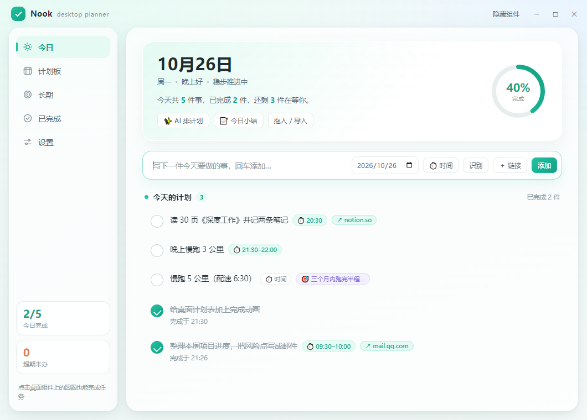
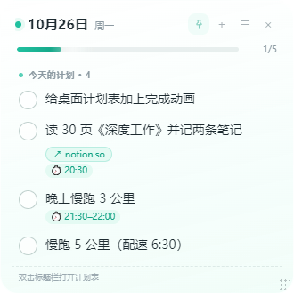

# Nook

> 贴在桌面一角的每日计划。

Nook 是一个常驻桌面角落的小计划表：写今天的计划、盯超期的事，点一下圆圈就算做完，旁边的透明小组件会顺口夸你一句。Electron 33 + 原生 HTML/CSS/JS，没有前端框架，也不依赖任何运行时库；不配 AI 时完全离线。





## 主要功能

- **每日计划**：按日期排任务，输入框回车即添加。过期未完成的自动进「超期」，可单条顺延，也可一键全部挪到今天。
- **计划板**：按周排未来几天，左右箭头翻周，每天显示待办条数，也能回头给过去某天补记。
- **长期计划**：建目标（标题 + 起止日期），任务挂到目标下，进度自动算；目标卡里可直接加任务，配了 AI 还能「帮我拆」。
- **桌面组件**：无边框、半透明、圆角小窗，默认停在屏幕右上角。可拖动、可缩放（宽 240–760，高 96–1200）、可置顶；显示项逐条开关（进度、提示、时间、超期、目标），4 种主题色（薄荷 / 晴空 / 蜜桃 / 紫藤）。
- **在组件上直接完成**：点圆圈完成任务，与主窗口实时同步；右键菜单含置顶、高度自适应、打开计划表、设置、隐藏、退出。
- **到点提醒**：任务设了时间段后，默认开始前 5 分钟与到点各提醒一次（系统通知 + 窗口内浮条）；提前量可调、声音可开。
- **粘贴 / 截图识别**：把聊天记录或清单粘进「识别」弹窗，或直接在主窗口按 Ctrl + V，自动拆成带日期、时间、链接的多条任务。截图识别走 Windows 自带 OCR（离线）。
- **AI 助手（可选，自带 Key）**：支持 DeepSeek / 通义千问 / Kimi / 智谱 GLM / 任意 OpenAI 兼容接口。五件事：文字或截图 → 任务、目标 → 未来几天计划、长期目标 → 一组任务、当天完成情况 → 今日小结、任务 → 完成凭证核对。
- **任务挂链接或程序**：每个任务可绑网址或本机程序（含 .lnk 快捷方式），点任务行的小按钮直接打开。
- **中英双语**：设置里切换，主窗口与组件同时生效。
- **托盘常驻 + 开机自启**：关闭主窗口只是收进托盘；开机自启只显示组件、不弹主窗口；单实例运行，重复启动会唤出已有窗口。

## 安装方法

### 方式一：用打包好的版本（推荐，普通用户）

1. 解压 `share\Nook-1.0.0-win64.zip`（约 110 MB）到任意目录，建议 `D:\Nook`，**不要**放进 `C:\Program Files`；
2. 双击 `Nook.exe`；
3. 首次运行 Windows 可能提示「已保护你的电脑」——点「更多信息 → 仍要运行」（未购买代码签名证书，属正常现象）。

`Nook.exe`（薄启动器）、`Nook Core.exe`（Electron 内核）、`resources\` 必须放在一起；**不要单独双击 `Nook Core.exe`**。需要 64 位 Windows 10 / 11。

### 方式二：从源码运行（开发）

需要 Node.js（含 npm）：

```powershell
cd desk-planner
npm install
npm start
```

`npm install` 只装两个开发依赖：`electron`（^33.2.0）与 `resedit`（构建时改写 exe 图标与版本信息）。程序本身没有运行时依赖。

### 方式三：自己构建便携版 / 分享包

```powershell
node tools\build_portable.js    # 构建到 D:\Nook（用环境变量 NOOK_OUT 改目录）
node tools\package_share.js     # 产出 share\Nook-<版本>-win64.zip
```

- 构建前请先在托盘里退出 Nook，文件被占用会失败。
- 便携版 = 同步 Electron 运行时 + 复制 `src` / `assets` / `package.json` + 改写图标与版本信息 + 用系统自带 `csc.exe` 编译 `tools\launcher.cs` 生成 `Nook.exe`，并附带 `启动 Nook.vbs`（无窗口启动）与 `使用说明.md`（即本文件）。
- 分享包在临时目录跑一遍上述构建，删除 `data`、`startup.log` 等本机痕迹后压缩，包内附 `先读我.txt`。

## 使用方法

### 主窗口

左侧五页：**今日 / 计划板 / 长期 / 已完成 / 设置**。

- **今日**：输入框写任务，回车添加；右侧「时间」先定时间段，「链接」绑网址或程序，「识别」拆一段话。任务行左侧圆圈点一下即完成，鼠标移上去行尾会出现「完成 / 顺延 / 链接 / 时间 / 删除」等操作；双击标题改名（回车保存、Esc 取消）。
- **计划板**：顶部 7 天条 + 上下周切换，点某一天的「＋」给它单独加任务。
- **长期**：右上「＋ 新建目标」填标题与起止日期；目标卡下可直接加任务；配好 AI 后「帮我拆」把目标拆成一组任务。
- **已完成**：按日期分组，点圆圈可撤销完成，右上角可清空记录。
- **设置**：语言、组件内容、外观与尺寸、窗口与启动（置顶 / 开机自启 / 显示或隐藏组件）、提醒、AI 助手、数据（打开文件夹 / 清空已完成 / 退出程序）。

### 桌面组件

- 按住标题栏拖动换位置（位置会记住），拖任意边缘改大小；标题栏图钉切换「显示在最上层」。
- 点圆圈完成任务；`＋` 加任务、`☰` 打开计划板、`×` 隐藏。
- 双击标题栏打开主窗口。

### 快捷键

| 快捷键 | 作用 |
| --- | --- |
| `Ctrl + N` | 主窗口聚焦输入框 |
| `Ctrl + Alt + P` | 全局唤出主窗口（任何程序前台都生效） |
| `Ctrl + V` | 输入框外粘贴即弹识别；粘贴的是图片则先 OCR |
| `Enter` / `Esc` | 弹窗中确认 / 取消 |

### 提醒

任务只有**设了时间**才会提醒：默认提前 5 分钟 + 到点各一次，发系统通知并在窗口或组件里浮一条；声音默认关闭。Windows 的「专注助手 / 勿扰模式」会拦截通知，需要把 Nook 放行。

## 示例

### 1. 一段话拆成多条任务

把下面这段粘进「识别」弹窗（或在主窗口按 `Ctrl + V`），点「开始识别」。以 2026-10-22（周四）为例：

```text
- 明天 10:00 提交季度报销单 https://example.com/report
2. 周四 下午 3:30 和设计团队评审方案
10月28日 整理本周项目进度并写邮件
下周三 9点半 交周报
```

识别结果：

| 标题 | 日期 | 时间 | 链接 |
| --- | --- | --- | --- |
| 提交季度报销单 | 2026-10-23 | 10:00 | https://example.com/report |
| 和设计团队评审方案 | 2026-10-22 | 15:30 | — |
| 整理本周项目进度并写邮件 | 2026-10-28 | — | — |
| 交周报 | 2026-10-28 | 09:30 | — |

解析规则（`src/renderer/shared/parsePlan.js`）：

- 日期认 `今天 / 今晚 / 明天 / 明早 / 明晚 / 后天 / 大后天 / 周X / 下周X / 下下周X / M月D日 / M-D`；
- 时间认 `10:00`、`下午3点半`、`9点`，带「下午 / 傍晚 / 晚上」自动 +12 小时；
- 链接认 `http(s)://` 与 `www.`；
- 行首的 `-`、`*`、`•`、`1.`、`2)` 以及「待办：」等前缀会被去掉；
- 没写日期默认今天；本地解析一次最多 40 条，重复的合并；标题为空时记为「（无标题，来自剪贴板）」。

这些用例都有单测：`node tools\test_parse.js`（当前 10 项全部通过）。

### 2. 接一个 AI 服务商

「设置 → AI 助手」打开开关 → 选服务商（接口地址与模型名会自动填好）→ 粘贴 API Key → 保存 → 点「测试一下」，返回「可用」即可使用。

| 服务商 | 接口地址（Base URL） | 文字模型 | 视觉模型 |
| --- | --- | --- | --- |
| DeepSeek | `https://api.deepseek.com` | `deepseek-flash` | `deepseek-flash` |
| 通义千问 | `https://dashscope.aliyuncs.com/compatible-mode/v1` | `qwen-flash` | `qwen-vl-plus` |
| Kimi | `https://api.moonshot.cn/v1` | `moonshot-v1-8k` | `moonshot-v1-8k-vision-preview` |
| 智谱 GLM | `https://open.bigmodel.cn/api/paas/v4` | `glm-4-flash` | `glm-4v-flash` |
| 自定义 | 自填 OpenAI 兼容地址（形如 `https://api.xxx.com/v1`） | 自填 | 自填 |

视觉模型留空时，图片自动退回本机 OCR。Key 用 Windows `safeStorage` 加密后存进 `plans.json`（系统不支持时退化为明文存储）。

### 3. 数据文件长什么样

`data\plans.json`（节选，v2 结构）：

```json
{
  "version": 2,
  "tasks": [
    {
      "id": "6f2c1a",
      "title": "提交季度报销单",
      "note": "",
      "link": "https://example.com/report",
      "date": "2026-10-23",
      "start": "10:00",
      "end": "",
      "parentId": null,
      "needsCheck": false,
      "done": false,
      "doneAt": null,
      "createdAt": "2026-10-22T01:12:30.000Z",
      "order": 0
    }
  ],
  "goals": [],
  "settings": {
    "app": { "lang": "zh", "autostart": false },
    "widget": { "width": 330, "opacity": 0.97, "accent": "mint" },
    "notify": { "enabled": true, "leadMinutes": 5, "atEnd": true, "sound": false },
    "ai": { "enabled": false, "provider": "deepseek" }
  }
}
```

- 每次保存都会同时写一份 `plans.backup.json`。
- 便携版优先把数据放在程序目录的 `data\`；目录不可写时退回系统 `%APPDATA%` 下的用户数据目录。
- `data\startup.log` 记录启动时间与异常栈，排查「双击没反应」时先看它。

### 4. 常用命令

```powershell
npm start                      # 开发模式运行
npm run shot                   # 截图模式：打开两个窗口并自动截图（开发用）
node tools\test_parse.js       # 解析规则单测，10 项
node tools\seed_demo.js <目录>  # 生成演示数据（--reset / --with-goals / --manual-size）
node tools\mock-ai.js 8710     # 本地假 AI 服务，接口地址填 http://127.0.0.1:8710/v1
node tools\build_portable.js   # 构建便携版到 D:\Nook
node tools\package_share.js    # 打包分享 zip
```

## 数据与隐私

所有任务与设置都在本地 `data\plans.json`。只有三种情况会联网：你点识别 / 拆解 / 小结 / 凭证核对（把那段内容发给你配置的 AI 服务商）、AI 测试连接、以及点击任务上的外部链接。没有账号、没有云端同步、没有统计上报。

## 许可

本项目以 MIT 许可证发布，版权与许可全文见 [LICENSE](LICENSE)（安装包内为 `resources\app\LICENSE`）。

## 更多

完整说明、交互细节与常见问题见 [docs/USER-GUIDE.md](docs/USER-GUIDE.md)。
